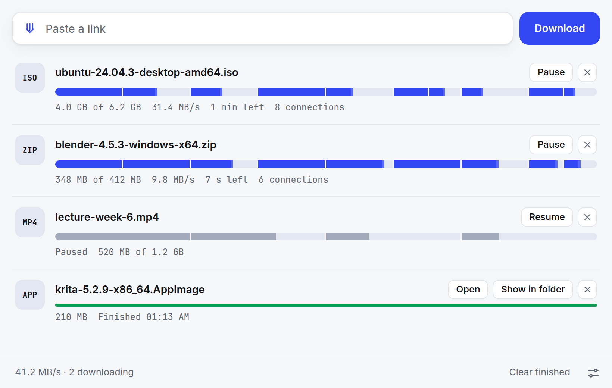

<p align="center">
  
</p>

<h1 align="center">indir</h1>

<p align="center">
  <b>A tiny download manager for Windows, macOS and Linux.</b><br>
  Paste a link. indir fetches the file in parts over several connections at once, so it arrives sooner,<br>
  and it can pause and carry on where it stopped, even after a restart.
</p>

<p align="center">
  <a href="https://github.com/akancodes/indir/releases/latest"><b>Download</b></a> ·
  Free and open source · No ads, no account, no tracking ·
  <a href="README.tr.md">Türkçe</a>
</p>

<picture>
  <source media="(prefers-color-scheme: dark)" srcset="docs/screenshot-dark.png">
  
</picture>

## Why indir

If you have used Internet Download Manager, this is the same idea with everything else taken out. A browser
fetches a file over one connection; many servers cap how fast a single connection may go, so a big file crawls.
indir splits the file into parts and fetches them side by side, then puts them back together. There is one window,
one field to paste into, and two settings.

## What it does

- **Fetches in parts.** Each part comes over its own connection, 8 by default. On a CDN that caps each
  connection, that is several times faster: a 148 MB kernel tarball took 2.6 seconds instead of 8.6.
- **Keeps every connection busy.** A connection that finishes early takes over half of the biggest part still on
  its way, so the end of a download never waits on one slow connection. One that goes quiet or slows to a trickle
  is taken over whole.
- **Backs off when a server wants it to.** Some servers punish visitors who open several connections, or refuse
  the extras with "429 Too Many Requests". indir notices, tries one connection on its own, and keeps whichever way
  is faster. It is never meant to be slower than your browser.
- **Pauses and resumes.** Stop a download and carry on later, even after quitting indir or restarting the
  computer. If the file on the server changed in the meantime, indir notices and starts it over.
- **Shrugs off bad connections.** A dropped or stalled connection is opened again exactly where it stopped.
- **Shows its work.** Each download's bar is the whole file, with every part filling in from its own start.
  When the file is complete, the parts close up into one bar.
- **Stays out of your way.** Light and dark follow your system. The progress also shows on the taskbar button
  or the Dock icon.

## Download

| System | File |
| --- | --- |
| Windows 10 and 11 | [indir-windows-setup.exe](https://github.com/akancodes/indir/releases/latest/download/indir-windows-setup.exe), or [indir-windows-portable.exe](https://github.com/akancodes/indir/releases/latest/download/indir-windows-portable.exe) to run it without installing |
| macOS 11 or later, Apple silicon and Intel | [indir-mac.dmg](https://github.com/akancodes/indir/releases/latest/download/indir-mac.dmg) |
| Linux | [AppImage](https://github.com/akancodes/indir/releases/latest/download/indir-linux-amd64.AppImage) · [.deb](https://github.com/akancodes/indir/releases/latest/download/indir-linux-amd64.deb) for Debian, Ubuntu and Mint · [.rpm](https://github.com/akancodes/indir/releases/latest/download/indir-linux-x86_64.rpm) for Fedora and openSUSE |

### Opening it the first time

indir isn't signed with a paid Apple or Microsoft certificate, so your system asks once before it runs:

- **Windows:** if SmartScreen says *Windows protected your PC*, click **More info**, then **Run anyway**. The
  installer installs for your user only and needs no administrator rights.
- **macOS:** open indir once. When macOS says it can't check the app, open **System Settings → Privacy &
  Security**, scroll down and click **Open Anyway**.
- **Linux:** make the AppImage executable (`chmod +x indir-linux-amd64.AppImage`) and run it, or install the
  .deb or .rpm.

## Using it

1. Copy a link to a file. In a browser, right-click the download link and choose *Copy link*.
2. Paste it into indir and press Enter. Several links at once work too, one per line, and so does dragging a
   link onto the window.
3. That's it. From the list you can pause, resume, open the file or show it in its folder.

**Settings** (bottom right) has where downloads go, your Downloads folder to begin with, and how many connections
each download may open: 1, 2, 4, 8 or 16. **Shortcuts:** Ctrl+L (⌘L on a Mac) jumps to the link field, Ctrl+,
(⌘,) opens Settings.

## How it works

1. **One small question first.** indir asks the server for the file's first byte only. A `206 Partial Content`
   answer means the server can send any part of the file, and says how big it is. A server that can't gets one
   ordinary connection.
2. **The file is split.** Into equal parts, one per connection, none smaller than 1 MB. Each connection asks for
   its part with an HTTP `Range` request and writes it straight to its place in a `.indir` file next to where the
   download ends up. Connections speak HTTP/1.1 on purpose: HTTP/2 would carry all of them over one TCP connection,
   which is exactly what a download manager avoids.
3. **Free connections help the others.** A connection that finishes takes over the second half of the biggest
   part still on its way. One that has sent nothing for 5 seconds, or crawls at a sixteenth of another's speed, is
   taken over whole and closed: some servers keep the extra connections at a trickle on purpose.
4. **The speed is watched.** If connections crawl like that, indir tries a single connection for a few seconds
   and keeps it if it does better than all of them together.
5. **Nothing is counted until it's on disk.** Progress is saved every few seconds, counting only bytes that have
   reached the disk, so a crash or a power cut costs a few seconds at most. When every byte is there, the
   `.indir` file gets its real name. An existing file is never overwritten: a second `report.pdf` becomes
   `report (1).pdf`.

The download engine is a Rust library of its own, in [`engine/`](engine), with tests that download from a local
server which can be slow, drop connections, refuse extra ones, trickle, go silent or change the file halfway. It
runs from a terminal too:

```bash
cargo run --release -p indir-engine --example get -- https://example.com/big.iso
```

## Good to know

- **Links that need you to be signed in won't work.** Some cloud drives, course sites and paid downloads only
  hand the file to your browser, which has your cookies; indir doesn't. Direct links do work: release pages,
  mirrors, CDNs and public file links.
- **Privacy.** indir sends nothing anywhere except the downloads you start, and one question to GitHub when it
  opens: whether a newer version is out. If one is, a note in the status bar links to it.
- **Where things are kept.** The list of downloads and the settings are two small JSON files in your app-data
  folder: `%APPDATA%\dev.akan.indir` on Windows, `~/Library/Application Support/dev.akan.indir` on macOS and
  `~/.local/share/dev.akan.indir` on Linux.
- **Removing a download** takes it off the list. A finished file stays where it is; an unfinished one's
  `.indir` file is deleted.

## Building from source

You need [Rust](https://rustup.rs), Node.js 18 or later, and on Linux the system libraries in Tauri's
[prerequisites](https://v2.tauri.app/start/prerequisites/) (WebKitGTK and friends).

```bash
npm install
npm run dev      # the app, reloading as you edit ui/
npm run build    # an installer for your system, in target/release/bundle
cargo test       # every test; the engine's need no window
```

| Folder | What's in it |
| --- | --- |
| [`engine/`](engine) | The download engine: the first question, the parts, the connections, the steering and resuming. No UI. |
| [`src-tauri/`](src-tauri) | The desktop app around it, built with [Tauri](https://tauri.app): the list, the settings, and the commands the window calls. |
| [`ui/`](ui) | The window: plain HTML, CSS and JavaScript, with no build step. |

Bug reports and pull requests are welcome. indir means to stay small, so a new feature has to earn its place.

## License

[MIT](LICENSE) © 2026 Bayram Akan
